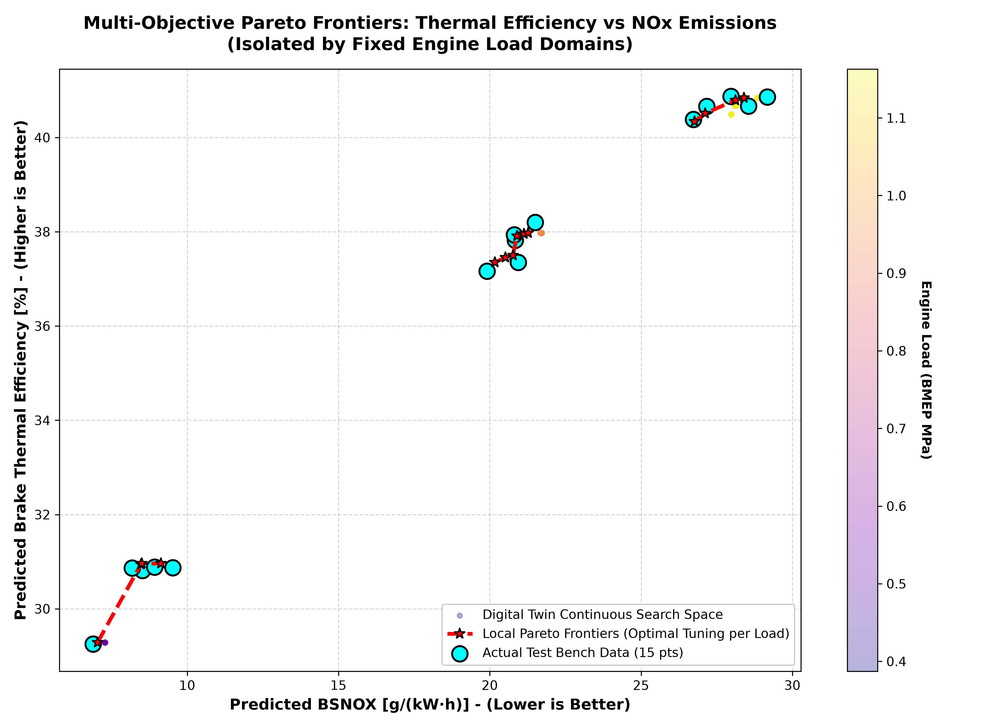

# Predictive Modelling for Dual-Fuel Engine Performance and Emissions Optimization

[Link to Live Dual Fuel Engine Interactive App ⚙️](https://dual-fuel-digital-twin.streamlit.app/)

<p align="center">

</p>

This project trains and evaluates surrogate machine learning models to predict Brake Thermal Efficiency (BTE) and exhaust emissions (BSNOX, BSCO2, BSTHC) based on engine load and methanol substitution ratios. Algorithms including Gradient Boosting, Random Forest, and Gaussian Process Regression are evaluated using Leave-One-Out Cross-Validation (LOOCV) to select the optimal model for an interactive machine learning web application.

## 📌 Project Overview

Optimizing the trade-off between thermal efficiency and exhaust emissions in dual-fuel engines requires evaluating non-linear operational boundaries. 

This project utilizes steady-state operating points from a heavy-duty natural gas engine modified with a methanol port-injection system. The models evaluate engine performance across light, medium, and heavy loads (BMEP of 0.387, 0.775, and 1.163 MPa) at a constant engine speed of 1600 rpm and an excess air ratio of 1.3.

## 🛠️ Technology Used

- **Machine Learning:** Scikit-learn (Gradient Boosting, Random Forest, Gaussian Process Regression)
- **Web Framework:** Streamlit
- **Data Science:** Pandas, NumPy
- **Visualization:** Matplotlib, Seaborn, Plotly
- **Dataset:** Research dataset from "Experimental investigation on performance and combustion characteristics of spark-ignition dual-fuel engine fueled with methanol/natural gas" by Chen et al. (2019).

## 🔳 Key Features

- **Multi-Target Surrogate Modeling:** Independent predictive `.pkl` models developed for four critical metrics: BTE, BSNOX, BSCO2, and BSTHC.
- **Model Validation Pipeline:** Utilizes Leave-One-Out Cross-Validation (LOOCV) to establish the optimal regression algorithm for the steady-state experimental data.
- **Interactive Dashboard:** Deploys a Streamlit web application (`streamlit_app.py`) for inference based on user-defined parameters.
- **Pareto Optimization:** Visualizes localized Pareto frontiers to identify operating points that balance thermal efficiency and emissions targets.

## 📁 Repository Structure

<pre>
├── data
│   ├── Data-for-Experimental investigation on the perfor...
│   └── processed_data.csv
├── result_images
│   ├── eda_correlation_heatmap.png
│   ├── eda_parametric_trends.png
│   ├── localized_pareto_frontier.png
│   └── model_performance_rmse.png
├── trained_models
│   ├── model_BSCO2.pkl
│   ├── model_BSNOX.pkl
│   ├── model_BSTHC.pkl
│   └── model_BTE.pkl
├── calc_functions.py
├── model_training.ipynb
├── process_data.py
├── README.md
└── streamlit_app.py
</pre>

## 🚀 Getting Started

### 1. Clone the Repository

```bash
git clone https://github.com/Oluwatobi-coder/Methanol_NG_Combustion_Project.git
cd Methanol_NG_Combustion_Project

```

### 2. Install Dependencies

```bash
pip install -r requirements.txt

```

### 3. Run the App

```bash
streamlit run streamlit_app.py

```


### 4. Process Data & Train Models (Optional)

* Execute the data preprocessing script to clean the raw experimental data:

```bash
python process_data.py

```


* Ensure both folders are placed in the `data` directory

* Run the cells in the `model_training.ipynb` to execute the LOOCV evaluation and export the trained `.pkl` models to the `trained_models` directory.


## 📊 Results

The surrogate models successfully predict the target variables across the defined operating envelope.

<p align="center">

</p>

### Performance Insights

<p align="center">

</p>

* **Efficiency Trade-offs:** The models capture the non-linear relationship between the methanol substitution ratio and Brake Thermal Efficiency (BTE) under varying BMEP loads.
* **Emissions Profiling:** Maps the response profiles between BSNOX and carbon-based emissions (BSCO2, BSTHC) to enable localized Pareto optimization.


## 📚 References

* Chen, Z., et al. (2019). Experimental investigation on performance and combustion characteristics of spark-ignition dual-fuel engine fueled with methanol/natural gas. *Applied Thermal Engineering*, 150, 164-174. https://doi.org/10.1016/j.applthermaleng.2018.12.168

## 📜 License

This project is licensed under the MIT License - see the `LICENSE` file for details.

If you find this Dual Fuel Digital Twin useful, please ⭐ the repository!
